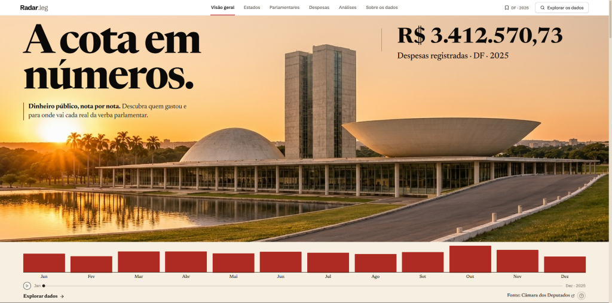

# Radar Legislativo

Aplicação completa de Engenharia de Dados e visualização pública para exploração das despesas parlamentares da **Cota para o Exercício da Atividade Parlamentar (CEAP)** da Câmara dos Deputados do Brasil, por unidade federativa, ano, categoria, parlamentar e fornecedor.



---

## Principais funcionalidades

- **Seleção por Estado (`UF`) e Ano** com cartograma geométrico interativo das 27 unidades federativas brasileiras e seletor acessível.
- **Hero editorial broadsheet com scrubber interativo**: composição inspirada em jornal impresso sobre papel creme (`#F3EDE1`), exibição animada do total líquido consolidado, exploração das 12 barras mensais (`Jan–Dez`) contra linha de média (`AVG`), slider interativo e reprodução automática.
- **Visão geral e governança do recorte**: indicação explícita de coleta completa, parcial, em andamento, falha, dados não coletados ou dados possivelmente desatualizados (`STALE_DATA_DAYS`).
- **Exploração de Parlamentares e Perfil Individual**: busca por nome, filtro por partido, histórico de mandatos (`/historico`), principais fornecedores com CNPJ/CPF formatado, distribuição por categoria, série mensal e link para a página oficial na Câmara.
- **Tabela de Despesas rastreável**: filtros combinados por UF, ano, parlamentar, categoria, mês e fornecedor/documento, paginação no servidor, exportação em CSV (`;` UTF-8 BOM), identificação de créditos/estornos SIGEPA e links diretos para documentos fiscais (DANFE/PDF) e endpoints da API.
- **Análises contextualizadas e popovers metodológicos (`?`)**: rosca SVG animada por categoria, área suave com revelação horizontal (`<clipPath>`) e média (`AVG`), dispersão (*bee-swarm*) dos parlamentares contra a mediana (`MED`), comparação multi-UF entre estados já coletados e abas deslizantes (**Gráfico | Dispersão | Tabela**).
- **Execução sob demanda e trilha de auditoria**: disparo assíncrono de coleta via interface (`POST /api/coletas`) ou CLI (`backend/run_pipeline.py`), mantendo tabela auditável em `execucoes_coleta`.

---

## Arquitetura do sistema

```text
API Dados Abertos (Câmara v2)
  ├── GET /legislaturas                   (mapeamento ano <-> idLegislatura)
  ├── GET /deputados?siglaUf&idLegislatura (paginação por links `next`)
  ├── GET /deputados/{id} + /historico    (detalhes e trajetória por legislatura)
  └── GET /deputados/{id}/despesas        (paginação `itens=100` + links `next`)
          │
          ▼
Pipeline ETL Python (`backend/app/etl/`)
  ├── client.py     → httpx com retry exponencial, timeouts e rate limiting
  ├── transform.py  → parsing de datas, limpeza, normalização de sinal e SHA-256
  └── loader.py     → carga idempotente por `chave_deduplicacao` e `chave_evento`
          │
          ▼
Banco Relacional (`db/schema.sql` · PostgreSQL 18 / SQLite de prévia)
  ├── legislaturas
  ├── deputados
  ├── deputado_mandatos_historico
  ├── deputado_recortes
  ├── execucoes_coleta
  └── despesas
          │
          ▼
API FastAPI (`backend/app/main.py`) ──► Frontend React 19 + TypeScript (`frontend/`)
```

---

## Decisões técnicas de Engenharia de Dados

Durante a inspeção direta dos endpoints reais de `https://dadosabertos.camara.leg.br/api/v2`, o pipeline resolveu quatro armadilhas reais da fonte oficial:

1. **Recorte histórico de legislaturas por ano**:
   Consultar `/deputados?siglaUf=UF` ou `/deputados/{id}/despesas?ano=2022` sem `idLegislatura` restringe os resultados à legislatura corrente (57ª), omitindo mandatos anteriores — inclusive janeiro de anos de transição como `2023` (mês 1 ainda pertence à 56ª Legislatura). O módulo `legislaturas_para_ano` em `transform.py` cruza o ano civil com o período de todas as legislaturas em `/legislaturas`.
2. **Normalização documentada de `valorLiquido`**:
   Verificou-se em respostas reais da API v2 que diversas categorias fora de SIGEPA são serializadas com `valorLiquido` negativo mesmo quando `valorDocumento >= 0` (enquanto o portal oficial exibe totais positivos), ao passo que bilhetes aéreos compensados em `PASSAGEM AÉREA - SIGEPA` têm tanto `valorDocumento < 0` quanto `valorLiquido < 0`. O pipeline preserva o campo bruto em `valor_liquido_api_raw`, calcula o valor líquido consistente (`valor_documento - valor_glosa` quando o documento não é negativo), marca `sinal_normalizado = TRUE` e preserva estornos negativos legítimos.
3. **Chave de deduplicação idempotente (`chave_deduplicacao`)**:
   Registros de `TELEFONIA` e `SERVIÇOS POSTAIS` chegam com `codDocumento = "0"`, e bilhetes aéreos SIGEPA podem repetir `codDocumento` entre compra, remarcação e estorno. Em `transform.py`, a deduplicação usa hash SHA-256 combinando deputado, período, documento, fornecedor, valores, parcela e índice de ocorrência dentro da resposta (`ocorrencia_idx`), evitando tanto duplicação em reexecuções quanto perda de estornos válidos.
4. **Resiliência a falhas parciais e preservação de histórico**:
   Se parte dos deputados falhar por timeout ou instabilidade da API durante uma coleta, o pipeline registra os erros por parlamentar em `execucoes_coleta`, marca a execução como `parcial` (ou `falhou` se nenhum deputado concluir) e **não apaga os dados válidos já persistidos** no banco.

---

## Stack e estrutura de pastas

- **Backend & ETL**: Python 3.14, FastAPI, SQLAlchemy 2.x, `psycopg` v3, `httpx`, Pydantic Settings, `pytest` + `respx`.
- **Banco de Dados**: DDL completo para PostgreSQL 18 em [`db/schema.sql`](db/schema.sql) e consultas analíticas SQL em [`db/queries.sql`](db/queries.sql), além de suporte a modo de prévia local em SQLite isolado (`RADAR_STORAGE_MODE=preview`) quando o servidor PostgreSQL ainda não estiver configurado com senha local.
- **Frontend**: React 19, TypeScript, Vite 6, GSAP (`ScrollTrigger`), Motion (`motion/react`), Lucide Icons.

```text
radar-legislativo/
├── backend/
│   ├── app/
│   │   ├── etl/          # client.py, transform.py, loader.py, pipeline.py
│   │   ├── config.py     # Configurações via .env e validação de storage
│   │   ├── db.py         # Engines SQLAlchemy, verificação de conexão e inicialização
│   │   ├── main.py       # Rotas REST FastAPI (/api/health, /meta, /overview, /deputados, /despesas, /analytics, /coletas)
│   │   ├── models.py     # Modelos relacionais ORM
│   │   ├── repository.py # Consultas analíticas, filtros, paginação e detecção de defasagem
│   │   └── schemas.py    # Contratos Pydantic de entrada/saída
│   ├── tests/            # Testes unitários e de integração (15 casos com respx + SQLite isolado)
│   ├── pytest.ini
│   ├── requirements.txt
│   └── run_pipeline.py   # CLI para execução direta do pipeline ETL
├── db/
│   ├── schema.sql        # DDL PostgreSQL 18 completo com constraints e índices
│   └── queries.sql       # Consultas SQL analíticas comentadas
├── docs/
│   └── screenshots/      # Captura real da interface local
├── frontend/
│   ├── src/
│   │   ├── components/   # Seções, cartograma 27 UFs, perfil, tabelas e animações
│   │   ├── services/     # Cliente HTTP tipado com distinção de erro 503 de banco
│   │   ├── styles/       # Design tokens e CSS responsivo com prefers-reduced-motion
│   │   ├── types/        # Tipagem espelhando os schemas da API
│   │   └── utils/        # Formatação pt-BR (R$, CNPJ/CPF, datas) e cartograma
│   ├── index.html
│   └── package.json
├── .env.example
├── docker-compose.yml
└── README.md
```

---

## Como configurar e executar localmente

### 1. Pré-requisitos

- Python 3.12+ (ambiente testado com Python 3.14.8)
- Node.js 20+ e `npm`
- PostgreSQL 18 (local ou via `docker-compose.yml`) **ou** uso do modo de prévia local (`RADAR_STORAGE_MODE=preview`)

### 2. Backend e Pipeline ETL

Crie o ambiente virtual e instale as dependências:

```powershell
python -m venv .venv
.\.venv\Scripts\python.exe -m pip install -r backend\requirements.txt
```

Configure o `.env` a partir de `.env.example`:

- **Com PostgreSQL 18 (produção / Docker Compose)**:
  ```powershell
  docker compose up -d
  ```
  Ajuste `DATABASE_URL` e `RADAR_STORAGE_MODE=postgres` no `.env` e aplique o DDL caso deseje criar manualmente em instância local:
  ```powershell
  psql -U radar_user -d radar_legislativo -f db/schema.sql
  ```

- **Nota de ambiente local**: se o serviço `postgresql-x64-18` local exigir senha ainda não definida no `.env`, utilize `RADAR_STORAGE_MODE=preview` no `.env` (a interface sinaliza explicitamente na barra superior o uso de `SQLite local (prévia): radar_preview.sqlite`, mantendo os **mesmos dados reais** coletados da API oficial).

Execute o pipeline para popular um recorte real (exemplos já verificados com dados oficiais):

```powershell
.\.venv\Scripts\python.exe backend\run_pipeline.py --uf DF --ano 2025
.\.venv\Scripts\python.exe backend\run_pipeline.py --uf AP --ano 2025
.\.venv\Scripts\python.exe backend\run_pipeline.py --uf DF --ano 2024
```

Inicie o servidor FastAPI:

```powershell
cd backend
..\.venv\Scripts\python.exe -m uvicorn app.main:app --host 127.0.0.1 --port 8000
```

### 3. Frontend

```powershell
cd frontend
npm.cmd install
npm.cmd run build
npm.cmd run preview -- --host 127.0.0.1 --port 5173
```

Acesse `http://127.0.0.1:5173/` no navegador (em desenvolvimento com HMR, também funciona via `npm.cmd run dev`).

### 4. Deploy na Vercel (Full-Stack Services)

O repositório já vem pré-configurado com Vercel Services em [`vercel.json`](vercel.json), entrypoint FastAPI em [`backend/main.py`](backend/main.py) e snapshot inicial em [`backend/app/radar_snapshot.sqlite`](backend/app/radar_snapshot.sqlite):

1. Importe o repositório `pedrohenriqueinv/radar-legislativo` diretamente na Vercel (Application Preset **Services**, Root Directory `./`).
2. A Vercel constrói o serviço `frontend` (Vite) e o serviço `backend` (FastAPI em `/api/*`) automaticamente no mesmo domínio.
3. Sem variáveis extras, o modo `RADAR_STORAGE_MODE=auto` inicializa `/tmp` com o snapshot real já coletado. Para persistência externa em produção, defina `DATABASE_URL` (PostgreSQL) nas Environment Variables da Vercel.

---

## Testes automatizados

### Backend (`pytest`)

```powershell
cd backend
..\.venv\Scripts\python.exe -m pytest -v
```

Os testes cobrem paginação por links `next`, retries e tratamento de erro HTTP/timeout (`respx`), normalização de datas e valores (`valorLiquido` / estornos), deduplicação com `codDocumento=0`, mapeamento de legislaturas em anos de transição (`2023`), idempotência em banco, preservação de dados após falha parcial e resposta `503` explícita da API quando o PostgreSQL está inacessível.

### Build e tipagem do Frontend

```powershell
cd frontend
npm.cmd run build
```

---

## Limitações e transparência metodológica

- Os dados carregados no banco dependem dos recortes `(UF, ano)` efetivamente coletados via CLI ou interface; recortes não coletados exibem estado vazio explícito sem números fictícios.
- Despesas da CEAP possuem prazos legais de prestação de contas na Câmara dos Deputados: meses recentes ou exercícios ainda em processamento podem apresentar totais parciais ou notas fiscais sem PDF anexado na fonte.
- Despesas registradas refletem uso regulamentar da cota parlamentar e **não constituem prova de irregularidade**, devendo ser analisadas considerando limites específicos por estado, exercício do mandato e categorias permitidas.
- Crédito de componentes visuais/animação integrados no frontend: `AnimatedContent` (GSAP + ScrollTrigger), `Magnet`, `SwipeToast`, `AnimatedNumber`, `AnimatedHBar` e `MethodPopover` (`motion/react`), implementados em TypeScript com respeito integral a `@media (prefers-reduced-motion: reduce)` e `<MotionConfig reducedMotion="user">`.
